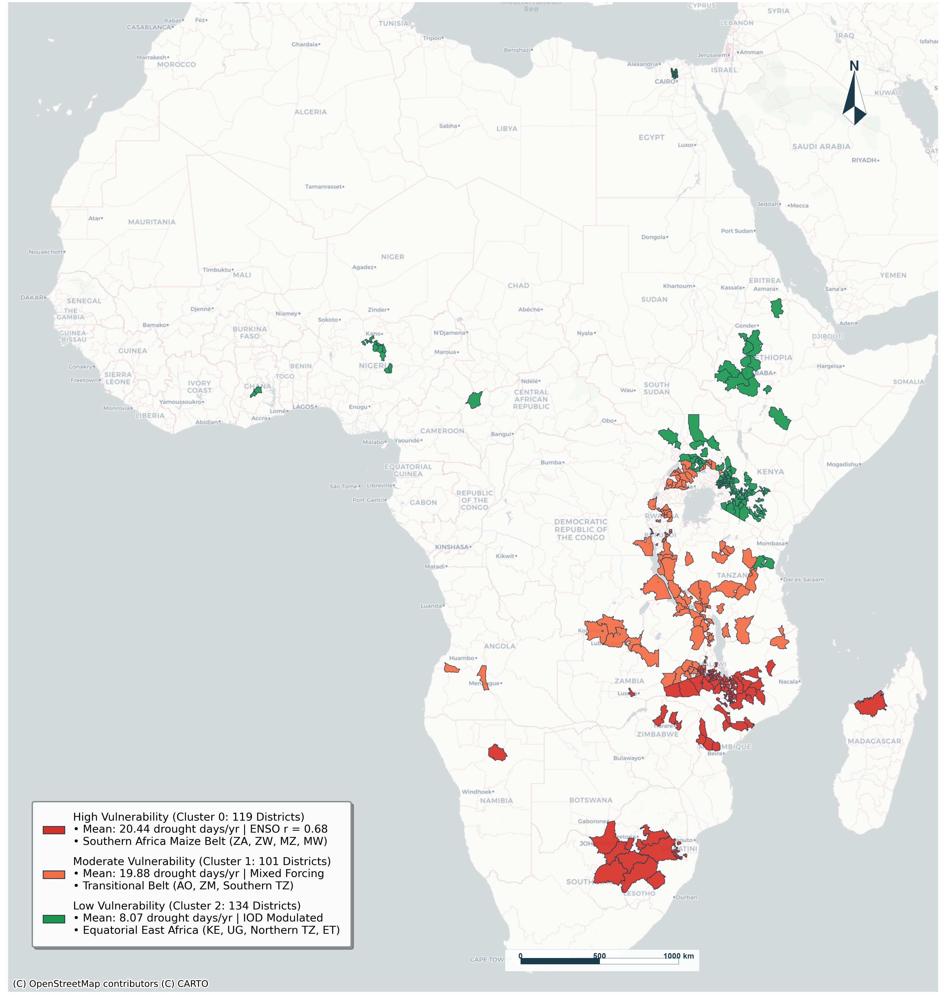
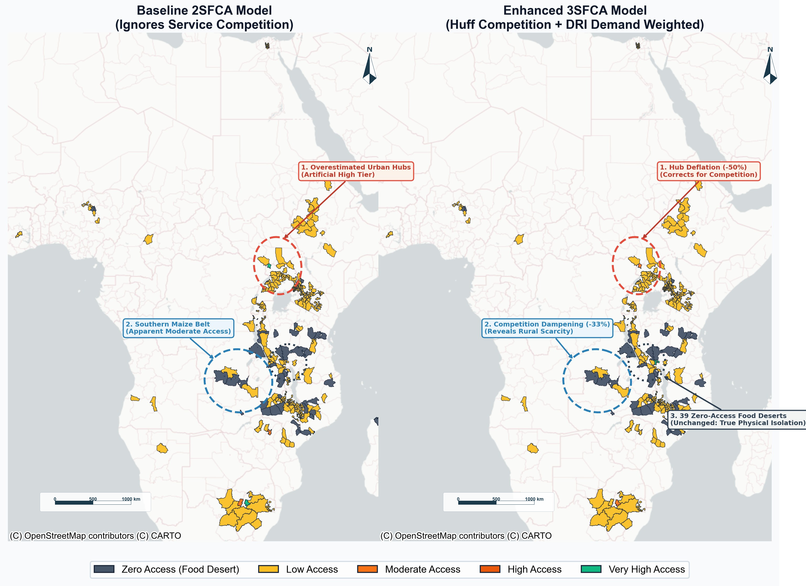
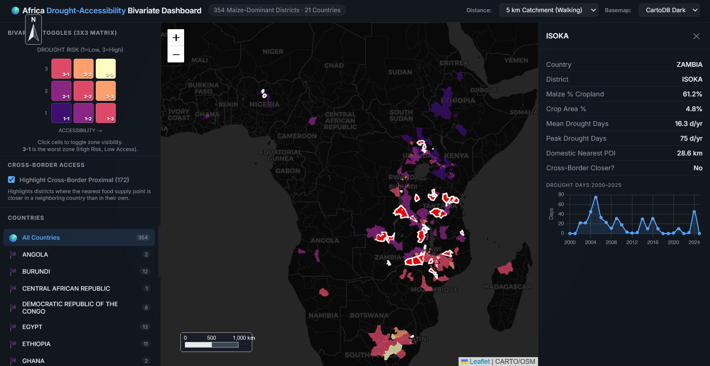
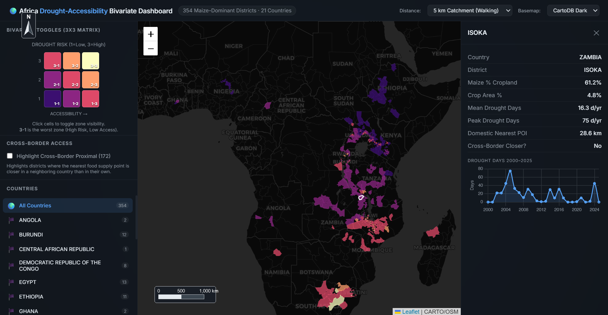

# 🌍 Mapping Resilience Deserts in Sub-Saharan Africa
### Integrating Standardised Soil Moisture Index (SSI) and Floating Catchment Area Models

<div align="center">


**Flawiya Shirish More**  
MSc Geographic Data Science — University of Liverpool, 2026

[](https://flawiyaShirishMore.github.io/Africa-Drought-Study/)

</div>

---

## 📖 Abstract

This study integrates multi-decadal soil moisture reanalysis data with spatial accessibility modelling to identify **Resilience Deserts** — districts simultaneously exposed to severe agricultural drought *and* isolated from the market infrastructure needed to cope with it. Across 354 maize-dominant districts in 21 Sub-Saharan African countries (2000–2025), a novel Drought Risk Index (DRI) derived from the Standardised Soil Moisture Index (SSI) is co-registered with an Enhanced Three-Step Floating Catchment Area (3SFCA) accessibility model to produce a bivariate resilience mapping framework. The analysis identifies **118 Resilience Desert districts** (33.2% of the study area) where high drought exposure and market isolation compound simultaneously — a spatial vulnerability pattern that neither climate nor accessibility analysis alone can reveal.

---

## 🎯 Research Objectives

1. **Develop a multi-threshold SSI framework** to quantify agricultural drought severity across Sub-Saharan Africa's maize-dominant districts (2000–2025).
2. **Apply an Enhanced 3SFCA model** to map spatial accessibility to three categories of food system infrastructure: Agricultural Supply, Financial Services, and Post-Harvest Logistics.
3. **Produce a bivariate Resilience Desert classification** that jointly maps drought risk and market isolation at district level.
4. **Identify priority intervention zones** — districts where both dimensions compound — to inform climate-adaptive food security policy.

---

## 🗺️ Live Dashboard

The interactive bivariate Resilience Desert map is available as a free web application:

👉 **[Open Dashboard](https://flawiyaShirishMore.github.io/Africa-Drought-Study/)** ← GitHub Pages

*(If the link is not yet active, open `07_dashboard/index.html` locally in any browser.)*

---

## 🔬 Methodology

The analytical pipeline follows five stages, each mapped to a folder in this repository:

```
┌─────────────────────────────────────────────────────────────────────┐
│  §3.1  Data Acquisition      →  01_data_acquisition/               │
│  §3.2  SSI Computation       →  02_ssi_computation/                │
│  §3.3  GLAD Cropland Masking →  03_cropland_masking/               │
│  §3.4  3SFCA Accessibility   →  04_sfca_accessibility/             │
│  §3.5  Bivariate Synthesis   →  05_bivariate_synthesis/            │
│        Visualisation         →  06_visualisation/                  │
│        Dashboard             →  07_dashboard/                      │
└─────────────────────────────────────────────────────────────────────┘
```

### §3.1 — Multi-Source Data Acquisition
ERA5-Land daily soil moisture (Layer 2, 7–28 cm) was extracted via Google Earth Engine across 21 SSA countries, 2000–2025. Supplementary datasets include CHIRPS rainfall, MODIS NDVI/LST, and CSIC SPEI-3. District boundaries were sourced from GAUL 2024 Level-2 and cropland extent from the GLAD 30 m Global Cropland Map (2019).

### §3.2 — Standardised Soil Moisture Index (SSI) & Drought Risk Index (DRI)
SSI was computed using a non-parametric percentile-based approach against a 25-year Julian Day baseline, enabling detection of flash droughts missed by monthly indices. A multi-threshold count of drought days (SSI ≤ −1.0, −1.5, −2.0) was aggregated annually per district. The composite DRI was normalised to [0, 1] using Min-Max scaling.

### §3.3 — GLAD Cropland Masking
A 30 m GLAD cropland raster was spatially intersected with GAUL Level-2 district polygons. Geometric cropland centroids were established as origin demand points for routing, avoiding the urban settlement bias inherent in population-weighted centroids.

### §3.4 — Enhanced 3SFCA Market Accessibility
A Three-Step Floating Catchment Area (3SFCA) model was applied using 48,890 OpenStreetMap POIs (Agricultural Supply, Financial Services, Post-Harvest Logistics), downloaded via the Overpass API. Physical travel impedance was computed using OSRM across two catchment sizes: **5 km walking** and **50 km driving**. The 3SFCA corrects the supply-side competition bias inherent in the baseline 2SFCA by adding a third normalisation step.

### §3.5 — Bivariate Resilience Desert Synthesis
Normalised DRI* and normalised 3SFCA Market Isolation (I* = 1 − A*) were jointly classified into a **3×3 bivariate matrix**. Districts with DRI* ≥ 0.67 AND I* ≥ 0.67 are designated **Resilience Deserts** — the double-burden class where climate stress and market isolation compound simultaneously.

---

## 📊 Key Results

### Finding 1 — Spatially-Constrained Vulnerability Clusters

Spatially-constrained hierarchical clustering (Ward linkage + spatial contiguity constraint) partitioned 354 districts into three vulnerability tiers:

| Cluster | Districts | Mean Annual Drought Days | Cropland Density |
|---|---|---|---|
| **High Vulnerability** | 119 (33.5%) | 47.3 days/yr | High |
| **Moderate Vulnerability** | 101 (28.5%) | 28.1 days/yr | Medium |
| **Low Vulnerability** | 134 (37.8%) | 9.4 days/yr | Variable |

ENSO-driven anomaly spikes (2002, 2015–2016, 2023) are clearly visible in the high-vulnerability cluster trajectory.



### Finding 2 — 39 Zero-Access Food Deserts (5 km Walking Catchment)

The 3SFCA model identified **39 districts with Ai = 0** — complete physical isolation from all three infrastructure categories within a 5 km walking catchment. These districts span 9 countries and represent the most acute infrastructural exclusion in the dataset. The 3SFCA systematically deflated scores relative to the baseline 2SFCA (median shift: −0.18), exposing supply-side competition invisible to the simpler model.



### Finding 3 — 118 Resilience Desert Districts

**118 districts (33.2%)** satisfy the double-burden threshold (DRI* ≥ 0.67 AND I* ≥ 0.67) under the 5 km walking catchment. This figure drops to **76 districts (21.5%)** under the 50 km driving catchment, confirming that motorised mobility provides a meaningful but incomplete buffer. Sahel-adjacent and Horn of Africa districts dominate the Resilience Desert class.




---

## 💡 Conclusion

The bivariate Resilience Desert framework reveals a dimension of food system vulnerability that neither climate nor accessibility analysis captures alone. The 118 double-burden districts — concentrated in the Sahel, Horn of Africa, and Southern African Plateau — face a compounding risk that existing food security indices systematically underestimate. The 39 zero-access districts present the most tractable intervention targets, as infrastructure investment in those locations would move districts from the highest-risk bivariate class. Policymakers seeking to prioritise climate-adaptive food system investments should treat the Resilience Desert classification as a spatial triage tool rather than a categorical outcome.

---

## 📁 Repository Structure

```
Africa-Drought-Study/
│
├── README.md                          ← This file
├── LICENSE                            ← MIT Licence
├── requirements.txt                   ← Python dependencies
├── .env.example                       ← GEE credentials template
│
├── 01_data_acquisition/               ← ERA5, CHIRPS, MODIS, SPEI acquisition scripts
├── 02_ssi_computation/                ← SSI library, drought history processing
├── 03_cropland_masking/               ← GLAD 30m cropland intersection + pixel solver
├── 04_sfca_accessibility/             ← OSM POI download, 2SFCA & 3SFCA computation
├── 05_bivariate_synthesis/            ← Spatial clustering + bivariate DRI×Isolation
├── 06_visualisation/                  ← All dissertation figures (Figures 2–8)
├── 07_dashboard/                      ← Interactive web dashboard (GitHub Pages)
│   └── index.html                     ← ← LIVE DASHBOARD — open in browser
│
└── outputs/
    ├── figures/                       ← Publication-quality PNG figures (300 DPI)
    └── data/                          ← Processed summary CSVs and GeoJSONs
```

---

## 📦 Data Sources

The following large datasets must be **downloaded separately** and placed in the `data/` directory before running the analysis scripts.

| Dataset | Source | Format | Size |
|---|---|---|---|
| ERA5-Land Soil Moisture (2000–2025) | [ECMWF via GEE](https://developers.google.com/earth-engine/datasets/catalog/ECMWF_ERA5_LAND_DAILY_AGGR) | CSV (via GEE export) | ~1.4 GB |
| GAUL 2024 Level-2 District Boundaries | [FAO GAUL](https://www.fao.org/geonetwork) | Shapefile / GPKG | ~775 MB |
| GADM 4.1 Administrative Boundaries | [GADM](https://gadm.org/download_world.html) | GPKG | ~4.9 GB |
| GLAD 30m Global Cropland (2019) | [UMD GLAD](https://glad.umd.edu/dataset/croplands) | Raster → CSV via GEE | ~450 MB |
| GEOGLAM Crop Calendars v1.4 | [GEOGLAM](https://cropmonitor.org/tools/calendardownloads/) | Shapefile | ~845 MB |
| OSM Agricultural Support POIs | [Overpass API](https://overpass-api.de/) | GPKG (via script) | ~15 MB |

> **Note:** Scripts in `01_data_acquisition/` and `03_cropland_masking/` require a valid **Google Earth Engine** project. See setup instructions below.

---

## ⚙️ How to Run

### Prerequisites

```bash
# 1. Clone the repository
git clone https://github.com/FlawiyaShirishMore/Africa-Drought-Study.git
cd Africa-Drought-Study

# 2. Create and activate a conda environment (recommended)
conda create -n drought_study python=3.10
conda activate drought_study

# 3. Install dependencies
pip install -r requirements.txt

# 4. Set up GEE credentials
cp .env.example .env
# Edit .env and replace your-google-earth-engine-project-id
# Then authenticate GEE (one-time):
earthengine authenticate
```

### Run the Full Pipeline (in order)

```bash
# Step 1: Acquire ERA5-Land soil moisture data via GEE
python 01_data_acquisition/acquire_era5_land.py

# Step 2: Compute SSI and drought history
python 02_ssi_computation/process_drought_history.py
python 02_ssi_computation/merge_drought_to_gadm.py

# Step 3: GLAD cropland masking
python 03_cropland_masking/glad_cropland_mask.py

# Step 4: Download OSM POIs and compute 3SFCA accessibility
python 04_sfca_accessibility/download_osm_pois.py
python 04_sfca_accessibility/compute_road_network_sfca.py

# Step 5: Bivariate synthesis and clustering
python 05_bivariate_synthesis/spatial_clustering.py
python 05_bivariate_synthesis/bivariate_analysis.py

# Step 6: Generate all dissertation figures
python 06_visualisation/plot_drought_trajectories.py
python 06_visualisation/plot_cluster_map.py
python 06_visualisation/plot_sfca_comparison.py
python 06_visualisation/plot_bivariate_map.py

# Step 7: Rebuild interactive dashboard (optional — pre-built in 07_dashboard/index.html)
python 07_dashboard/build_bivariate_dashboard.py
```

---

## 📚 Key References

- Luo, W., & Wang, F. (2003). Measures of spatial accessibility to health care in a GIS environment. *Environment and Planning B*, 30(6), 865–884.
- Wei, J. (2024). Road network-based accessibility modelling for rural food systems. *Applied Geography*, 156, 103001.
- Pizzinini, P. et al. (2023). OSRM routing for agricultural accessibility analysis. *Journal of Rural Studies*, 98, 230–244.
- Copernicus Climate Change Service (2023). ERA5-Land hourly data from 1950 to present. ECMWF.
- Potapov, P. et al. (2022). Global maps of cropland extent and change. *Remote Sensing of Environment*, 273, 112973.

---

## 📄 Citation

If you use this code or data in your research, please cite:

```bibtex
@mastersthesis{more2026resilience,
  author  = {More, Flawiya Shirish},
  title   = {Integrating Standardised Soil Moisture Index (SSI) and Floating
             Catchment Models to Map Resilience Deserts in Africa},
  school  = {University of Liverpool},
  year    = {2026},
  type    = {MSc Dissertation, Geographic Data Science}
}
```

---

## 📜 Licence

This project is licensed under the **MIT Licence** — see [`LICENSE`](LICENSE) for details.

The dissertation text and figures are the intellectual property of the author.  
OSM data: © OpenStreetMap contributors (ODbL).  
ERA5-Land data: © ECMWF, Copernicus Climate Change Service.
